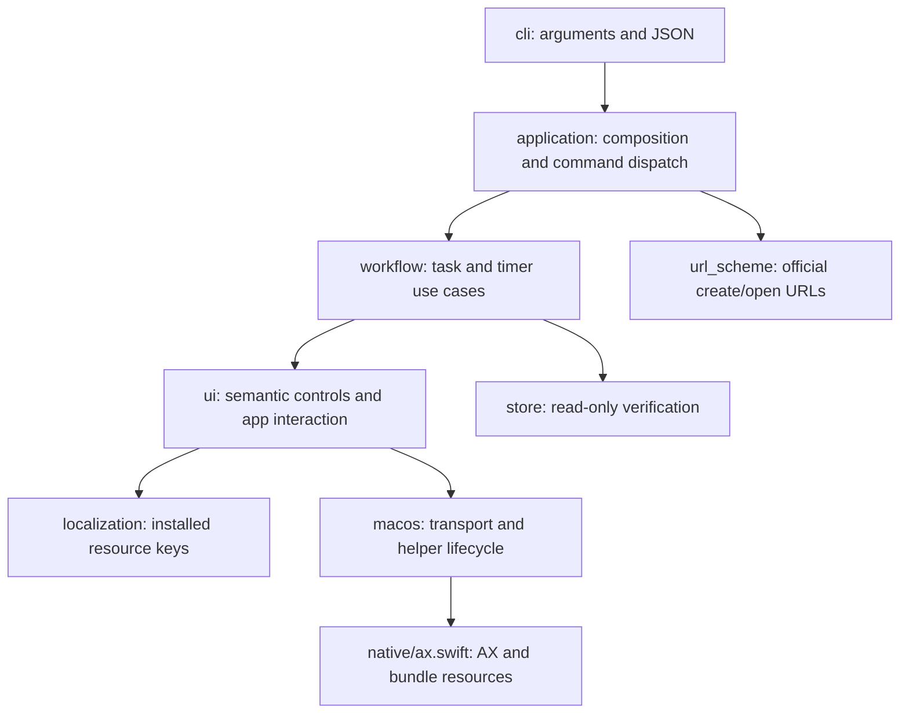

# Architecture

[Documentation](README.md) · English | [简体中文](../zh-CN/architecture.md) | [日本語](../ja/architecture.md)

The CLI exposes stable task and timer semantics while Bluebird owns data changes. No code writes to the app's SQLite store.

`domain.py` contains field normalization and task identity checks. `runtime.py` provides polling and the shared per-user mutation lock. Dependencies point away from `cli.py`; neither the UI adapter nor workflows import the parser or command dispatcher. `Application` accepts store/bridge dependencies, and `Workflow` accepts a semantic UI adapter for tests.

## Localization

1. The native bridge finds the installed bundle and reads only requested `Localizable.strings` keys. No app translations are copied into this repository.
2. `localization.STRINGS` maps semantic names to resource keys and development-language defaults. The sparse `en` table needs those defaults. Regional variants inherit their base table when present.
3. Role-qualified anchors detect the UI language. App/system preferences resolve tied variants; incompatible evidence requires an explicit `--locale`. That flag validates rather than changing the app language.
4. `ui.CONTROLS` describes roles, stable identifiers, and semantic names. Identifiers take precedence. The tag picker's system Back button is also identified by its unique navigation-bar relationship to the stable `plus` control inside the popover: UIKit may expose text that differs from Bluebird's translation. Ambiguous navigation structures are rejected. Text matching normalizes NFC, whitespace, and bidi display marks; emoji joiners are retained.
5. User task titles remain data. Matching allows locale-specific punctuation but rejects duplicate/prefix collisions. Custom task actions are resolved from their localized descriptions at runtime.
6. Actions include the snapshot tree path plus observed identity attributes. The native helper checks both again and requires exactly one target. When an animation moves a path, the adapter may refresh and retry only if the native helper confirms no action was performed and exactly one element still has the same observed identity and selection state. Ambiguity or changed identity stops the action.

The resource matrix proves label resolution and selector contracts for each locale. It cannot prove that every app screen exposes the expected Accessibility structure; live checks are recorded separately.

## Writes and failures

A shared cache lock serializes each mutation. Task IDs are strings, read from the store before locating a unique visible row. An editor's title is verified before editing. Notes/tag names use actual Unicode input: the helper verifies full text selection before replacement because AXValue assignment alone does not reliably persist in Catalyst.

After a UI action, workflows poll the read-only store for the requested state. Timeout returns `UNVERIFIED`, never inferred success. Multiple fields may already have changed; callers should re-read before retrying. External device changes and manual UI activity are outside the process lock.

The package includes Swift source, not a precompiled binary. `setup` compiles into a writable per-user cache; a SHA-256 source stamp prevents using a helper from a different CLI source version. Installing via pip does not require writing into the package directory at runtime.

## Extension points

For a new app control, add its resource key and selector in the existing localization/UI modules, implement the semantic interaction, and test read-back behavior. Do not add translated literals to workflows. For a schema change, update `Store`'s validation and temporary database fixtures together. Changes to commands must update `capabilities`, the project READMEs, documentation in all three languages, and the agent skill when relevant.

## Authorization and local web management

`auth.py` owns code digests, grant persistence, functional permissions, and stable tag-ID scopes. `web.py` provides the loopback owner console; `web_assets` supplies the English/Chinese/Japanese interface. The console edits a separate authorization SQLite database, never Bluebird's store. The browser uses an ephemeral admin token; agent codes cannot administer grants.

`Application` checks the specific command permission and nonempty all-tags scope before reads, dry runs, URL dispatch, or UI work. Writes resolve the grant again after acquiring the mutation lock. Workflows recheck task scope when reading targets, while duplicate-title checks still use the complete store. Read results and timer metadata are filtered. Revocation affects subsequent commands, not rollback of in-flight UI actions. New CLI commands must be explicitly added to the permission catalog or classified as public/owner-only; unknown code operations are denied. See [authorization](authorization.md) for the OS trust boundary.
