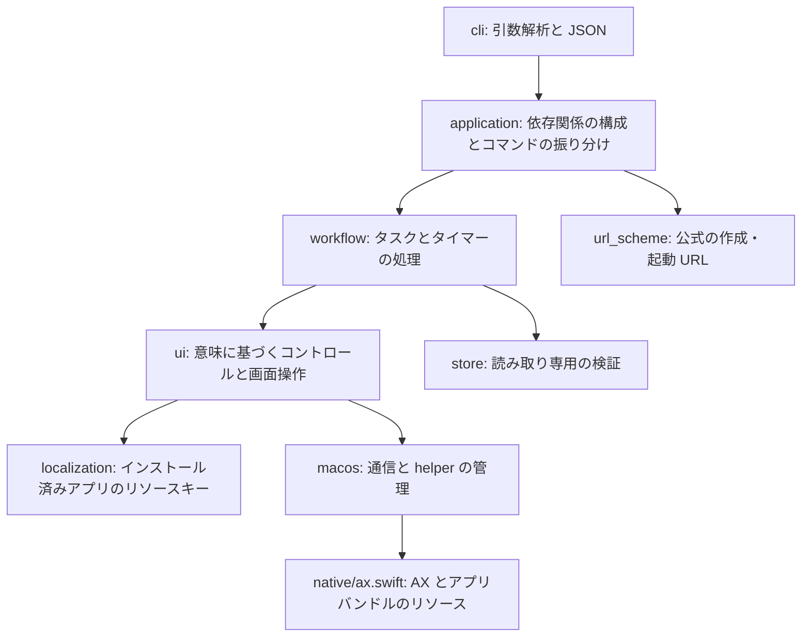

# アーキテクチャ

[ドキュメント一覧](README.md) · [English](../en/architecture.md) | [简体中文](../zh-CN/architecture.md) | 日本語

CLI はタスクとタイマーに対して一貫した操作を提供し、データの変更は Bluebird 自身が実行します。アプリの SQLite データベースへ直接書き込むコードはありません。

`domain.py` はフィールドの正規化とタスクの識別を、`runtime.py` はポーリングとユーザー単位で共有する更新ロックを担当します。内部モジュールは `cli.py` に依存しません。UI アダプターと処理フローは、引数パーサーやコマンドの振り分け処理をインポートしません。テスト時には `Application` にストアと bridge を、`Workflow` に意味に基づく UI アダプターを注入できます。

## 多言語対応

1. ネイティブ bridge はインストール済みのアプリバンドルを探し、必要な `Localizable.strings` のキーだけを読み取ります。アプリの翻訳データはリポジトリにコピーしません。
2. `localization.STRINGS` は、操作上の意味を表す名前をリソースキーと開発言語の既定値に対応付けます。基本の `en` テーブルは項目が少ないため、既定値で補います。地域別の言語は、基本言語のテーブルが存在する場合にその内容を継承します。
3. コントロールのロールと文言を組み合わせて UI 言語を判定します。地域別の候補が同点の場合は、アプリまたはシステムの言語設定を使います。判定が一致しない場合は `--locale` の明示指定が必要です。このオプションは言語を検証するもので、アプリの言語設定は変更しません。
4. `ui.CONTROLS` はロール、安定した識別子、意味を表す名前を定義し、識別子を優先します。タグ選択画面のシステムの戻るボタンは、ポップオーバーのナビゲーションバー内で安定した `plus` コントロールとの位置関係が一意であることも使って特定します。UIKit の文言は Bluebird の翻訳と異なることがあるためです。構造が曖昧な場合は操作を拒否します。テキスト比較では NFC、空白、双方向テキストの表示制御文字を正規化し、絵文字の結合文字は保持します。
5. ユーザーのタスク名は常にデータとして扱います。言語ごとの句読点を許容しますが、同名や接頭辞による衝突は拒否します。タスク固有のアクションは、実行時にローカライズ済みの説明から解決します。
6. アクションには、スナップショットのツリーパスと観測した識別属性を含めます。ネイティブ helper は両方を再検証し、対象がちょうど一つであることを要求します。アニメーションでパスが変わった場合、ネイティブ側が未実行を確認でき、更新後も識別属性と選択状態が一致する対象が一つだけなら再試行できます。対象が曖昧になったり識別情報が変わったりした場合は停止します。

リソースのテスト行列は各言語の文言解決とセレクターの仕様を検証します。ただし、すべての画面が想定どおりのアクセシビリティ構造を公開することは証明できません。実際の画面での検証は別に記録します。

## 書き込みとエラー処理

共有キャッシュのロックで更新操作を直列化します。タスク ID は文字列として保持し、ストアから取得した後、一意に識別できる表示中の行を探します。編集前にはエディターのタイトルを確認します。メモとタグ名は実際の Unicode 入力を使い、置換前に helper が全文の選択範囲を検証します。Catalyst では AXValue の設定だけでは保存されない場合があるためです。

UI 操作後は、読み取り専用ストアをポーリングして要求された状態を確認します。タイムアウト時は `UNVERIFIED` を返し、成功とは推定しません。一部のフィールドは変更済みかもしれないため、再試行前に読み直してください。他のデバイスからの変更や手動の UI 操作は、このプロセスロックの対象外です。

パッケージにはコンパイル済みバイナリではなく Swift ソースを含めます。`setup` はユーザーが書き込めるキャッシュへコンパイルします。SHA-256 のソースダイジェストにより、異なる CLI ソース版の helper の使用を防ぎます。pip でインストールした後、実行時にパッケージのインストール先へ書き込む必要はありません。

## 拡張方法

新しいコントロールを追加する場合は、既存の言語対応/UI モジュールにリソースキーとセレクターを追加し、意味に基づく操作と読み戻し検証を実装します。処理フローに翻訳文字列を直接追加しないでください。スキーマ変更時は `Store` の検証と一時データベースのテストデータを同時に更新します。コマンド変更時は `capabilities`、プロジェクト README、3 言語のドキュメント、影響を受けるエージェントスキルも更新します。

## 認証とローカル管理画面

`auth.py` はコードのダイジェスト、権限の永続化、機能権限、タグ ID の範囲を管理します。`web.py` はループバック限定の所有者 API、`web_assets` は英語・中国語・日本語の画面を提供します。権限は Bluebird とは別の SQLite DB に保存します。ブラウザーの一時管理トークンとエージェントコードは別で、コードで管理 API は利用できません。

`Application` は照会、プレビュー、URL 呼び出し、UI 操作の前に個別機能と非空の全タグ条件を検査します。変更時はプロセスロック取得後に権限を再取得します。ワークフローは対象を読む際に範囲を再確認し、同名タスクの判定は全ストアを使います。照会結果とタイマー情報も範囲で制限します。失効は後続コマンドに適用され、実行中の UI 操作は取り消しません。新規コマンドは権限一覧か公開/所有者専用に明示的に分類し、不明なコード操作は拒否します。OS の信頼境界は[認証の説明](authorization.md)を参照してください。
