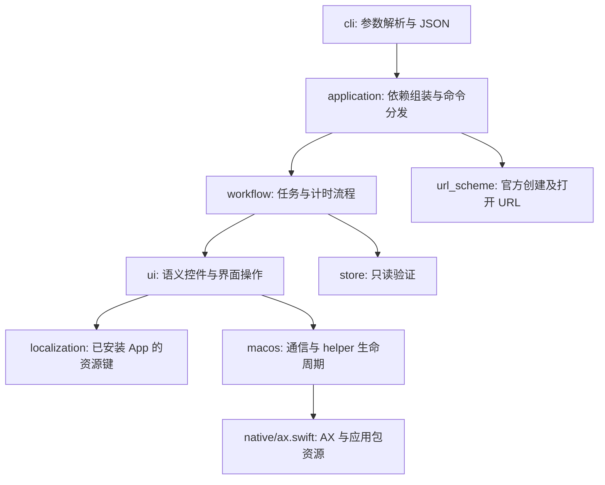

# 架构说明

[文档目录](README.md) · [English](../en/architecture.md) | 简体中文 | [日本語](../ja/architecture.md)

CLI 提供稳定的任务和计时操作语义，数据变更由 Bluebird 自身执行。代码不会写入 App 的 SQLite 数据库。

`domain.py` 负责字段规范化和任务身份检查，`runtime.py` 提供轮询及同一用户共享的修改锁。内部模块不反向依赖 `cli.py`；UI 适配器和业务流程均不导入参数解析器或命令分发器。`Application` 可以注入存储和 bridge，`Workflow` 可以注入语义 UI 适配器，便于测试。

## 多语言适配

1. 原生 bridge 定位已安装的应用包，只读取需要的 `Localizable.strings` 资源键。仓库不复制 App 的翻译内容。
2. `localization.STRINGS` 将语义名称映射到资源键及开发语言默认值。基础 `en` 表内容较少，需要默认值补全。地区变体在基础语言表存在时继承其内容。
3. 通过控件角色与文案共同识别界面语言。App 或系统的语言偏好用于消除地区变体之间的歧义；证据冲突时需要显式指定 `--locale`。该参数用于验证语言，不修改 App 的语言设置。
4. `ui.CONTROLS` 定义控件角色、稳定标识符和语义名称，优先使用标识符。标签选择器的系统返回按钮还通过弹层导航栏中与稳定 `plus` 控件的唯一关系识别，因为 UIKit 暴露的文案可能与 Bluebird 翻译不同。导航结构不唯一时拒绝操作。文本匹配会规范化 NFC、空白和双向文字显示标记，同时保留 emoji 连接符。
5. 用户任务标题始终作为数据处理。匹配兼容不同语言的标点，但拒绝同名或前缀冲突。任务的自定义动作在运行时通过本地化描述解析。
6. 每次动作携带快照树路径及观察到的身份属性。原生 helper 再次验证两者，并要求恰好一个目标。动画导致路径移动时，只有原生层确认未执行动作，且刷新后仍有唯一控件具有相同身份及选中状态，适配器才会重试。目标有歧义或身份变化时停止操作。

资源矩阵验证各语言的文案解析与选择器约定，不能证明每个页面均暴露预期的辅助功能结构；真实界面检查单独记录。

## 写入与失败处理

共享缓存目录中的锁将修改操作串行化。任务 ID 保持为字符串，先从存储读取，再定位唯一可见任务行。编辑前验证编辑器标题。备注和标签名采用真实 Unicode 文本输入：替换前由 helper 验证全文选区，因为仅设置 AXValue 在 Catalyst 中不一定会持久保存。

执行 UI 动作后，业务流程轮询只读存储以确认目标状态。超时返回 `UNVERIFIED`，不会推断为成功。部分字段可能已经变更，调用方应先回读再决定是否重试。其他设备的数据变更和用户手动操作不受进程锁约束。

安装包分发 Swift 源码，不包含预编译二进制。`setup` 编译到当前用户可写的缓存目录；SHA-256 源码摘要可防止使用与 CLI 源码版本不符的 helper。通过 pip 安装后，运行期间无需写入包安装目录。

## 扩展方式

新增 App 控件时，在现有语言适配/UI 模块中添加资源键和选择器，实现语义操作并测试回读行为，不要在业务流程中加入翻译字符串。数据库结构变化时，同时更新 `Store` 的校验和临时数据库测试数据。命令变更时，同步更新 `capabilities`、项目 README、三种语言的文档，以及受影响的 Agent 技能。

## 授权与本机管理页面

`auth.py` 管理 code 摘要、授权持久化、功能权限和稳定标签 ID 范围。`web.py` 提供仅本机访问的所有者管理 API，`web_assets` 提供中英日三语页面。授权写入独立 SQLite 库，不写 Bluebird 数据库。浏览器使用临时管理员令牌，Agent code 无法管理授权。

`Application` 在读取、预览、URL 派发和界面操作之前检查具体功能及“非空且全部标签在范围内”的规则。写操作取得进程锁后重新读取授权。工作流读取目标时再次检查标签范围，同名任务检查仍基于完整数据。查询结果与计时信息均按范围过滤。撤销作用于后续命令，不回滚执行中的 UI 动作。新增命令须明确加入功能目录或划为公共/所有者命令，未知功能对 code 默认拒绝。操作系统信任边界见[授权说明](authorization.md)。
